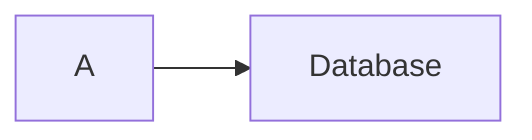

# Fork maintenance and upstream boundaries

Foundation: [ivarvong/lantern](https://github.com/ivarvong/lantern) at `2c7bad533be25fbd56d26a9a2b6c5651743f011e`. The original MIT notice remains in `LICENSE`; the inherited README is preserved in `docs/UPSTREAM-README.md`. The new product layer lives in `explain/`, `integrations/agentic-mermaid/`, `app/embed*`, the external-scene tools and `scenes/explainers/`. Original scenes, the original player and the engine's public runtime export names are retained.

The current checkout has an `upstream` remote. Other clones can add it explicitly:

```sh
git remote add upstream https://github.com/ivarvong/lantern
git fetch upstream
```

Merge deliberately, rerunning inherited tests, the explainer portfolio, style fidelity and package gates. Do not overwrite downstream product code with a blind vendor refresh.

## Demonstrated engine changes

| Change | Why | Evidence |
| --- | --- | --- |
| Recursively flatten AnimationGroup members | Nested groups previously animated objects that were never added to the scene | Failing regression observed, then fixed in `test/explain.test.ts` |
| Restore original FadeOut opacity | Re-showing styled artwork turned faint marks fully opaque | Failing 0.14-opacity regression observed, then fixed |
| Optional SVG paint semantics and cache invalidation | Real styles need line caps/joins, dashes, fill rule, miter limit and paint order | Twelve-style non-text renderer comparison and all authored snapshots |
| Interpolate optional style fields at exact endpoints | A native-to-styled transform previously omitted newly introduced paint fields; reverse easing also needs restoration | Failing add/remove/there-and-back regression observed, then fixed |
| `Scene.onStep(listener)` and `Scene.addDescriber(fn)` | Helpers wrapped `scene.step` and `scene.describe` per instance, which a second wrapper would fight | `test/explain-emphasis.test.ts`; golden traces unchanged |
| `Step.hold`: when a step's caption-reading hold begins | The player kept "playing" a still frame through the hold; video still needs it | Golden traces changed only by gaining the field (stripping it reproduces the old hashes) |
| Fixed rectangular paint viewports | Visual review found zoomed diagram backgrounds painting over the heading | Real nested/translated raster regression failed before the fix; copy/record immutability, exact seeking and browser SVG namespaces/references are tested |
| Layout: one left-to-right order of each scope's blocks on every rank, blocks shifted clear in that order, push-out to the ordered side, and an error instead of a silent give-up (inherited from upstream, fixed here) | A cluster spanning several ranks could sit on different sides of a node on different ranks; step 6 then chased the node for 400 passes and returned it about 1,800 units away inside a box it does not belong to | `test/flowchart.test.ts`: "clusters spanning several ranks keep non-members out" pins the 4 charts the random property found (it fails on the old layout); "layout invariants on random flowcharts" passes 20,000 charts under `FULL=1`; the lantern scene's layout is unchanged |
| `Mobject.pointKind()`: point arrays blend only with arrays of the same kind | A one-curve path and a Text's advance box are both 8 floats, so equal length alone made them blend: a line morphing into a Text landed on the text box's corners instead of collapsing to its centre | `test/property.test.ts`: "a one-curve path morphing into a Text collapses to the text's centre", and "Transform lands exactly on its target" at 300 random scenes |
| Caption holds wait whole frames, rounded up | `wait(left)` rounded to the nearest frame, so a captioned step could end up to half a frame short of its reading time (and set `hold` with no frame waited), against "a step lasts at least that long" | `test/scene-hooks.property.test.ts`: "a captioned step lasts at least its reading time", "a hold is recorded exactly when the step waited"; golden traces for just-bash, exgit and lantern change by those frames |
| A caption of no words holds for no time | `''.split(/\s+/)` is `['']`, so an empty or blank caption counted as one word and held the step 0.375 s | `test/scene-hooks.property.test.ts`: "a caption with no words needs no hold" |
| `onStep`/`addDescriber` removers remove only their own registration; a dispatch skips listeners removed during it and does not run ones added during it | Removers filtered by function identity, so registering one function twice and calling one remover removed both; a listener added mid-dispatch ran for the step already in progress | `test/scene-hooks.property.test.ts`: "each onStep registration runs once per step…", "a listener removed during a step…", "registering the same describer twice…" |
| `describe()` copies describer keys as own keys and refuses a describer that returns no object | `Object.assign` turned a JSON `"__proto__"` key into the result's prototype; a describer returning `undefined` failed with a JSON SyntaxError | `test/scene-hooks.property.test.ts`: "describe is the state merged…", "a describer that does not return an object is refused" |
| `parseColor` reads #rgba and #rrggbbaa, and returns null for anything that is not hex | Snapshot palettes may use 4- and 8-digit hex; `lerpColor` then produced `#NaNNaNNaN` (and named colours did the same mid-transform) | `test/explain-helpers.test.ts`: "soft, raised and rule give a colour for every palette the snapshot validator accepts" |

Offer the general fixes upstream separately from the product layer. No upstream submission or acceptance is claimed here. External scene registration and video tooling stay downstream so this fork does not depend on an upstream decision.

## Agentic Mermaid

The optional build dependency is pinned to **0.4.1**. Browser artifacts never import it. `build/capture.ts` is the small adapter to `registerBackend`, `createMermaidRenderer` and `drawNode`; capture must equal plain `renderMermaidSVG` byte for byte. CSS and SVG lowering are build-only and fail on unread artwork. Compact resolved snapshots form the runtime boundary.

Agentic Mermaid is the same owner's project, so these are changes to release in 0.5 rather than requests:
1. A documented per-mark renderer returning stable `{id, svg}` records and resources.
2. Stable label/tick/legend identities across typed mutations.
3. A distinct `state` family report (0.4.1 reports it as flowchart; the adapter normalizes this).
4. Preserve labels declared after a prior bare-id reference.

Reproduction for the last issue:



In 0.4.1 this can render B as “B”. Declare labels before their first use. The build emits a diagnostic when its heuristic recognizes an explicit bracket/round/decision label but the captured node still displays its bare id; that diagnostic is not a complete Mermaid source linter. An integration test checks the real 0.4.1 case. Do not silently rewrite the source or invent a label after capture; that would stop being the renderer's own output.

All fourteen explainers use one authored style each. Diagram fonts remain embedded Inter rather than style-specific fonts, as documented. Other SVG resources and Mermaid families are not implied by the eight-family test portfolio.

## Release gates that tests cannot substitute for

Choose the public product/package name and accountable maintainer, have an independent author follow the documentation on a clean machine, and validate the bytes/headers actually served after deployment. The automated archive smoke test is valuable distribution evidence, but it is not that independent author or a public release. An exact port of the private/unavailable 2password source also needs that source; the current demo explicitly identifies its fixture scope.
