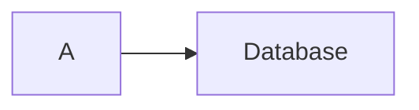

# Fork maintenance and upstream boundaries

Foundation: [ivarvong/lantern](https://github.com/ivarvong/lantern) at `2c7bad533be25fbd56d26a9a2b6c5651743f011e`. The original MIT notice remains in `LICENSE`; the inherited README is preserved in `docs/UPSTREAM-README.md`. The new product layer lives in `explain/`, `integrations/agentic-mermaid/`, `app/embed*`, the external-scene tools and `scenes/explainers/`. Original scenes, the original player and the engine's public runtime export names are retained.

The current checkout has an `upstream` remote. Other clones can add it explicitly:

```sh
git remote add upstream https://github.com/ivarvong/lantern
git fetch upstream
```

Merge deliberately, rerunning inherited tests, the explainer portfolio, style fidelity and package gates. Do not overwrite downstream product code with a blind vendor refresh.

## Demonstrated engine changes

| Change | Why | Evidence |
| --- | --- | --- |
| Recursively flatten AnimationGroup members | Nested groups previously animated objects that were never added to the scene | Failing regression observed, then fixed in `test/explain.test.ts` |
| Restore original FadeOut opacity | Re-showing styled artwork turned faint marks fully opaque | Failing 0.14-opacity regression observed, then fixed |
| Optional SVG paint semantics and cache invalidation | Real styles need line caps/joins, dashes, fill rule, miter limit and paint order | Twelve-style non-text renderer comparison and all authored snapshots |
| Interpolate optional style fields at exact endpoints | A native-to-styled transform previously omitted newly introduced paint fields; reverse easing also needs restoration | Failing add/remove/there-and-back regression observed, then fixed |
| Fixed rectangular paint viewports | Visual review found zoomed diagram backgrounds painting over the heading | Real nested/translated raster regression failed before the fix; copy/record immutability, exact seeking and browser SVG namespaces/references are tested |

Offer the general fixes upstream separately from the product layer. No upstream submission or acceptance is claimed here. External scene registration and video tooling stay downstream so this fork does not depend on an upstream decision.

## Agentic Mermaid

The optional build dependency is pinned to **0.4.1**. Browser artifacts never import it. `build/capture.ts` is the small adapter to `registerBackend`, `createMermaidRenderer` and `drawNode`; capture must equal plain `renderMermaidSVG` byte for byte. CSS and SVG lowering are build-only and fail on unread artwork. Compact resolved snapshots form the runtime boundary.

Upgrade requests for upstream:
1. A documented per-mark renderer returning stable `{id, svg}` records and resources.
2. Stable label/tick/legend identities across typed mutations.
3. A distinct `state` family report (0.4.1 reports it as flowchart; the adapter normalizes this).
4. Preserve labels declared after a prior bare-id reference.

Reproduction for the last issue:



In 0.4.1 this can render B as “B”. Declare labels before their first use. The build emits a diagnostic when its heuristic recognizes an explicit bracket/round/decision label but the captured node still displays its bare id; that diagnostic is not a complete Mermaid source linter. An integration test checks the real 0.4.1 case. Do not silently rewrite the source or invent a label after capture; that would stop being the renderer's own output.

All fourteen explainers use one authored style each. Diagram fonts remain embedded Inter rather than style-specific fonts, as documented. Other SVG resources and Mermaid families are not implied by the eight-family test portfolio.

## Release gates that tests cannot substitute for

Choose the public product/package name and accountable maintainer, have an independent author follow the documentation on a clean machine, and validate the bytes/headers actually served after deployment. The automated archive smoke test is valuable distribution evidence, but it is not that independent author or a public release. An exact port of the private/unavailable 2password source also needs that source; the current demo explicitly identifies its fixture scope.
