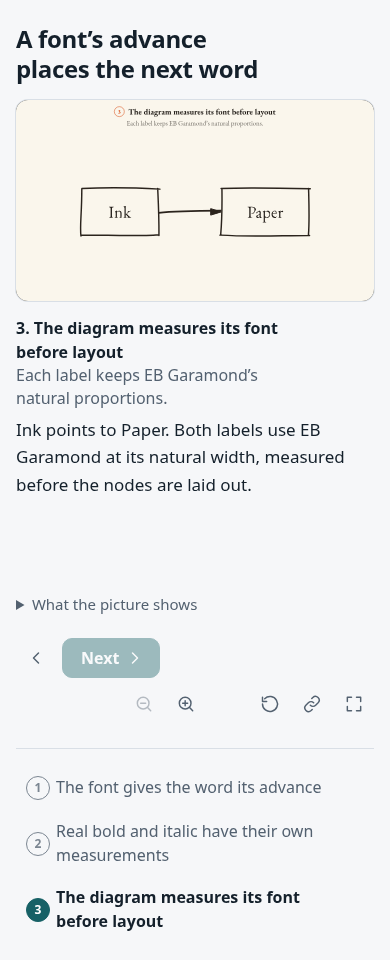
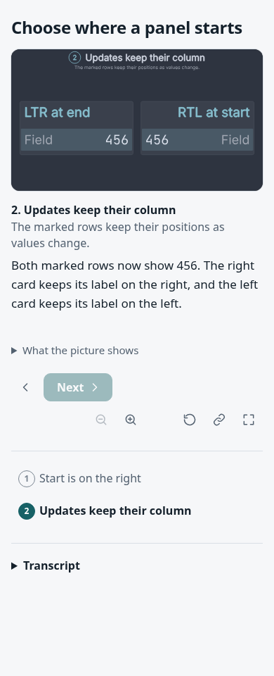

# Natural lettering and spatial direction

The evidence renders the final `font-metrics/scene.ts` and `layout-direction/scene.ts` inputs through each revision's production collector, page builder and HTTP server. Both widths use Chromium 154. Images and receipts are captured from served pages.

The baseline is `712120634ac15db8276e9b463ca7883b98cbfcc5`, before these authoring options existed. Its archived tree receives only the two final scene inputs. Its own locked dependencies and real lettering pipeline generate the baseline snapshots. The baseline ignores the natural-lettering field and still fits EB Garamond into Agentic Mermaid's old widths. Logical `start`/`end` placement fails with `TypeError: REGIONS[r] is not iterable`; there is no fabricated before image for that unsupported surface. The new fixture's caption describes the requested behavior, which the baseline fails to provide.

The current producer is `36ee0e7c37d08d12dc5635671bf9caec4b22d666`. Later test, evidence and traffic-policy framing changes leave these two inputs and their rendering unchanged. [Base receipt](base/capture.json) and [current receipt](head/capture.json) record matching hashes for both scene inputs.

| Fitted lettering at the baseline | Natural lettering |
| --- | --- |
|  |  |



Desktop captures are in the same directories. The direction baseline's [actual error](base/layout-direction.txt) is preserved.

Compare the label proportions and the space reserved around them. In the direction example, both cards remain together; the right card's label is right-aligned, the left card overrides field order, and both values read `456`. These images establish those examples at two widths. They do not establish every font, diagram family or physical-phone experience.

`capture.json` records the immutable producer revision, exact scene-input hash, browser, dependency version, page hash and image hashes. The base and head receipts must name identical input hashes. The [font vectors](font-vectors.json) come from HarfBuzz over original font bytes; the tests also compare captured outlines with an independent font renderer. The [audit record](audit.md) lists the counterexamples found and repaired.

To regenerate, archive the recorded baseline and install from its lockfile, then copy the two named final scene files into their corresponding locations. With the documented Chromium, Python and font-cache environment:

```sh
# Run each tree's own command from that tree:
node tools/explain.ts snapshots scenes/explainers/font-metrics --refresh
# Run this generator from the head checkout for each tree:
node docs/evidence/authoring-layout/capture.ts \
  --source /path/to/base --out out/layout-evidence-base \
  --ref 712120634ac15db8276e9b463ca7883b98cbfcc5 --unsupported-direction
node docs/evidence/authoring-layout/capture.ts \
  --source /path/to/head --out out/layout-evidence-head \
  --ref 36ee0e7c37d08d12dc5635671bf9caec4b22d666
```

Use the exact recorded producer revisions. A different renderer or source edit requires new snapshots and receipts; copying capture metadata is not regeneration.
