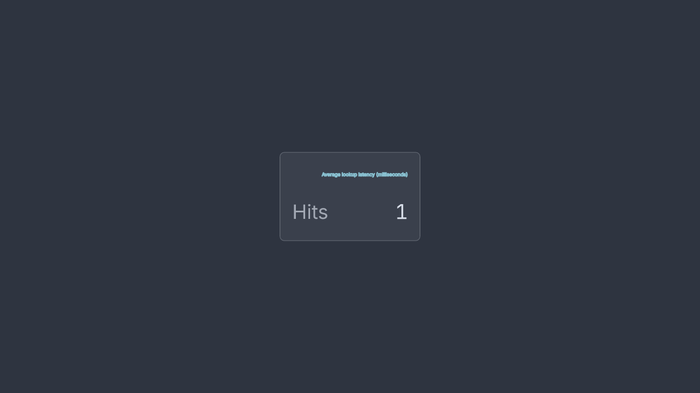
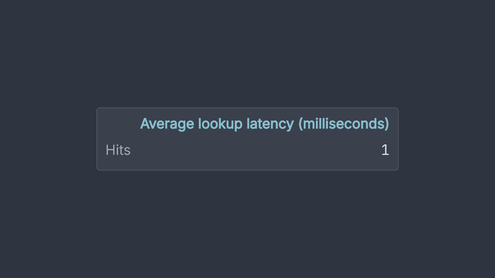

# Card heading sizing

An uncapped card now grows to keep its column heading at the authored font size. Previously, the same heading shrank because the natural-width calculation ignored headings when there was one column or every row had a spanning value.

The input is [`scene.ts`](scene.ts): one Hits row, one column headed “Average lookup latency (milliseconds)”, font size 0.45, and no width or placement cap. Both images use that exact file and the production renderer at 1280 px.

Baseline SHA: `0d4921bf99900242f733d1d17556e961ac6493d9`.

Rendered head SHA: `b010d68819a0f1f9f7ef1ccdad06145fe7f8a839`.

| Before | After | What to inspect |
| --- | --- | --- |
|  |  | The heading keeps its authored size; the row still reads Hits 1. |

[`receipt.json`](receipt.json) records both revisions, the shared input hash and the image hashes. The property test `uncapped columned cards keep headings at their authored size with single-value rows` in `test/explain-panels.property.test.ts` checks heading size and containment across 1–6 columns, LTR/RTL and varied font sizes. It fails without the sizing fix (`FC_SEED=66`).

To reproduce from this checkout, give each revision its own dependencies, then run the same renderer script against both:

```sh
git worktree add --detach ../rayner-card-before 0d4921bf99900242f733d1d17556e961ac6493d9
git worktree add --detach ../rayner-card-after b010d68819a0f1f9f7ef1ccdad06145fe7f8a839
npm ci --prefix ../rayner-card-before
npm ci --prefix ../rayner-card-after
node docs/evidence/card-heading-sizing/render.mjs ../rayner-card-before /tmp/card-before.png
node docs/evidence/card-heading-sizing/render.mjs ../rayner-card-after /tmp/card-after.png
```

The fixture is supplied to both revisions from this evidence directory; it was added after the baseline. The renderer script imports each selected checkout's production code and does not implement a separate layout.

Limitation: this comparison covers one uncapped desktop card. It does not establish phone layout or results with other fonts.
