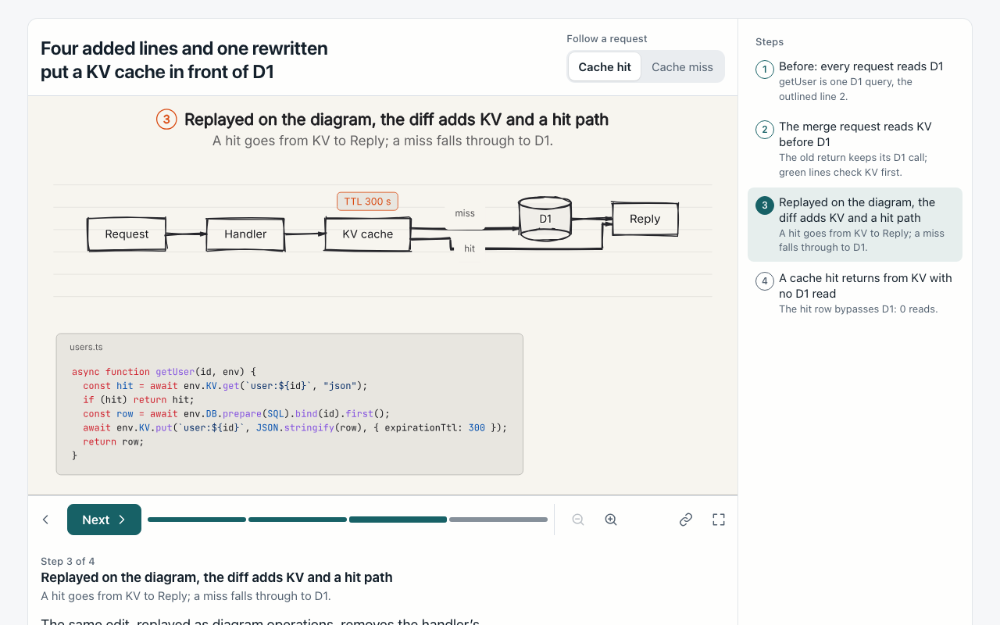
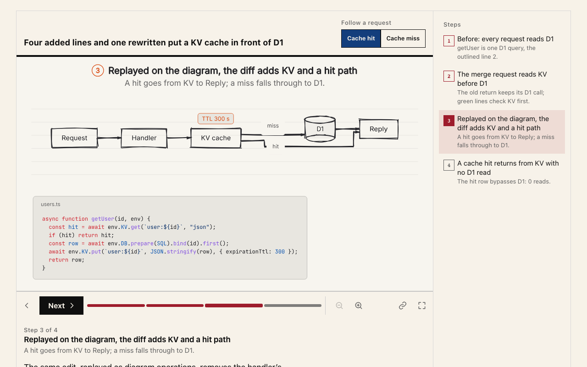
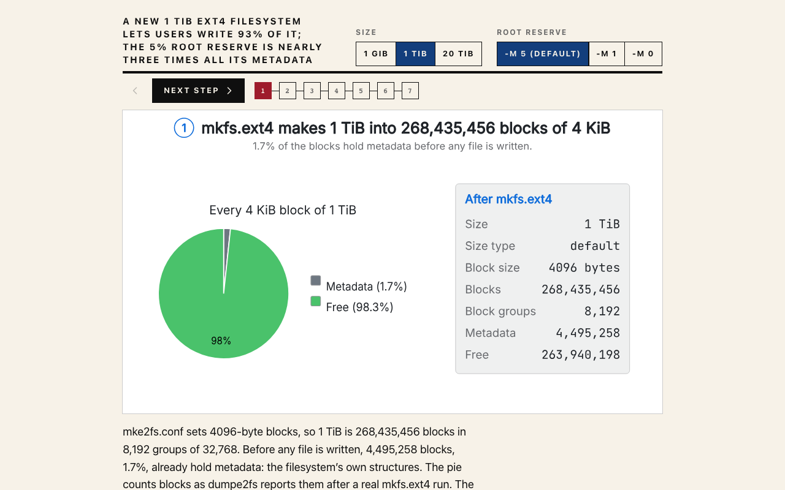
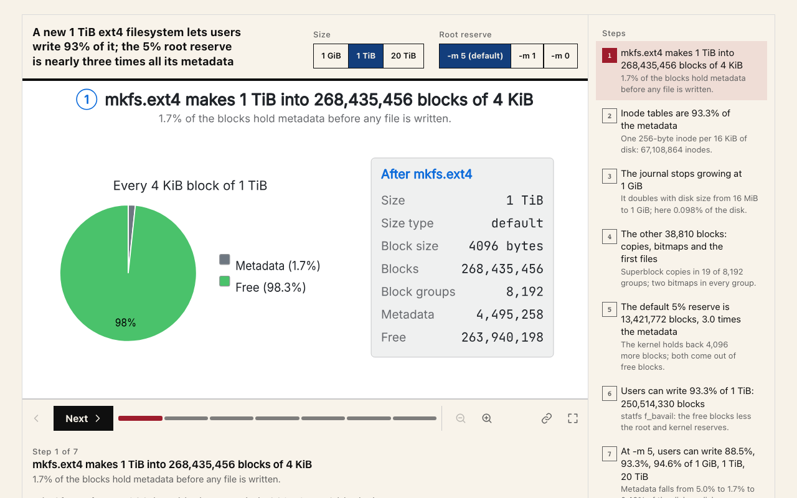
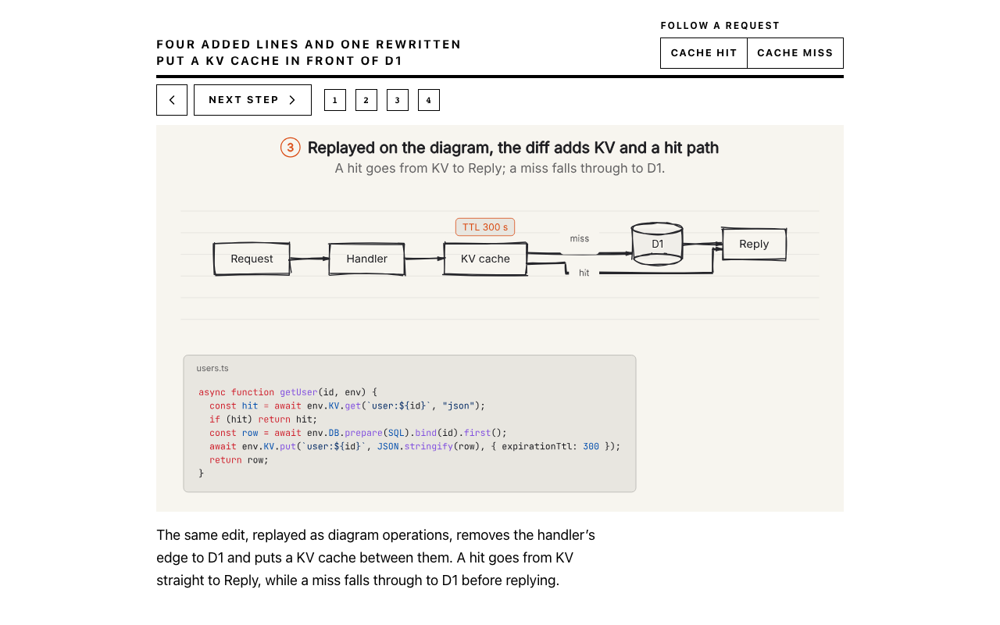
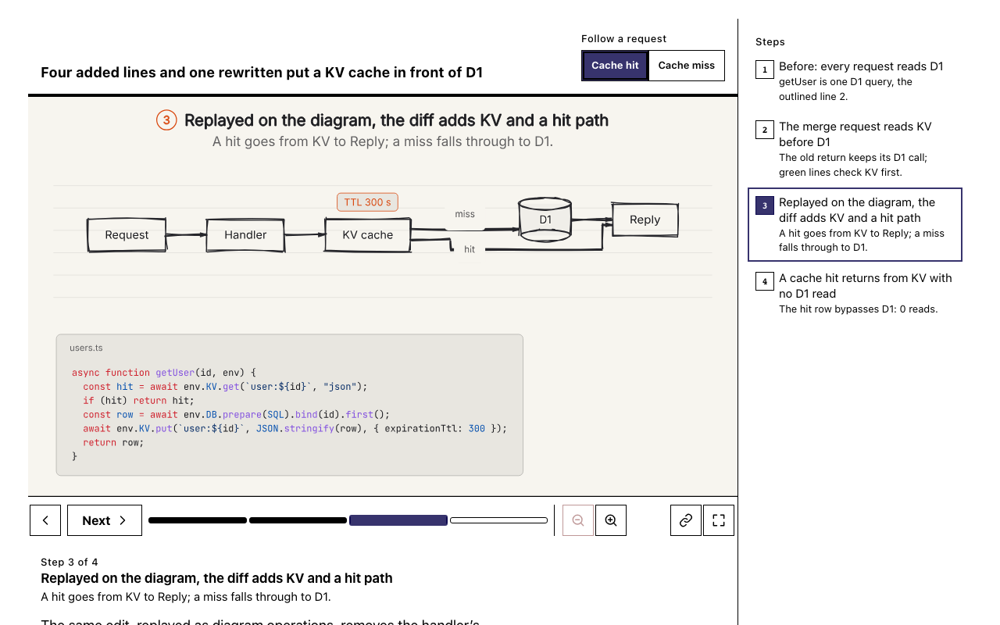
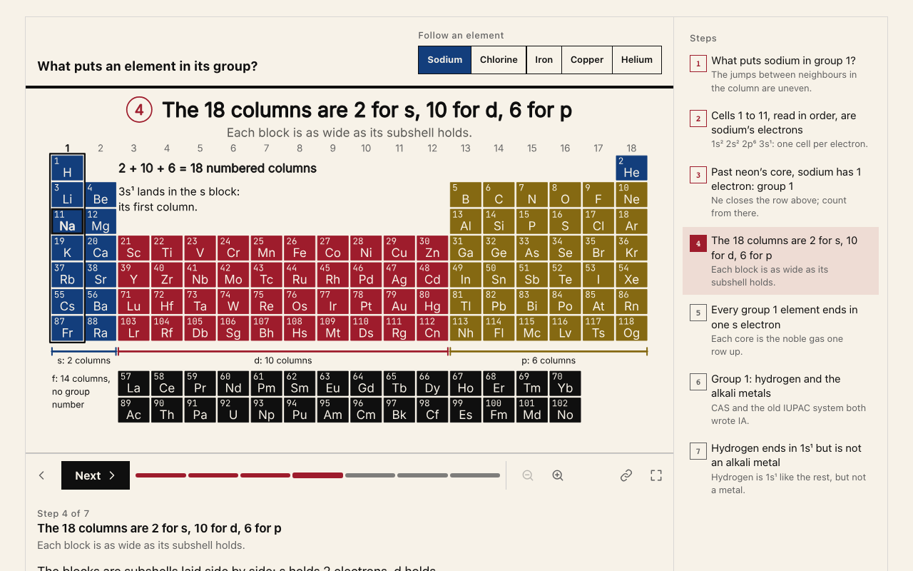
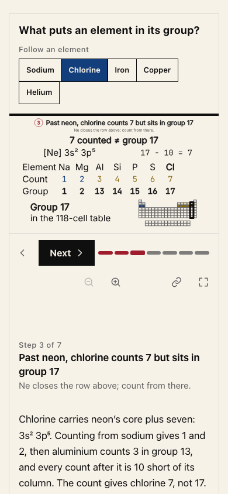
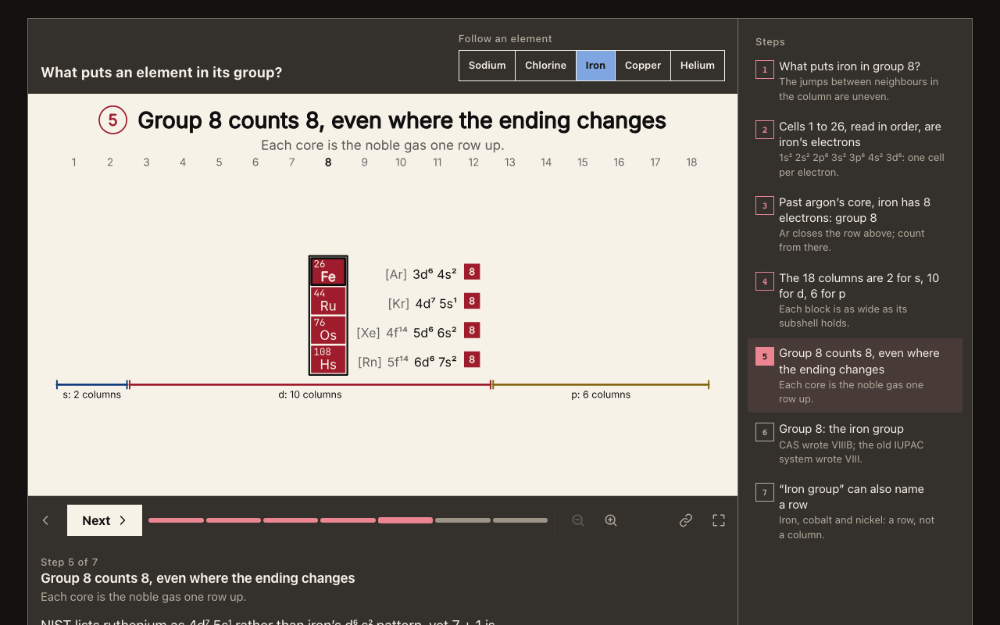

# PR 60: integrated player and audit repairs

The periodic-table lesson uses Atlas's block colours and the current player navigation. The shared player preserves authored identifier case and shows selected cases under forced colours.

## Inputs and source revisions

- **Main baseline:** `11ff5694757646185f238e22b4f7cb050c6a337b`.
- **Original PR baseline:** `83d3b14b3ab890a34568bd2ecde3033189af72f7`.
- **Source head SHA:** `2a904f50c7e1a4dd7ff0b61f09f6a9859d18864f`, also recorded in `after-receipt.json`. The later evidence-only commit adds these images without changing their source.
- Chromium, reduced motion, fresh direct links, with generated response headers. Each receipt records browser version, viewport, query, SHA-256 image hashes, observed settings and console errors.

| Input | Before | After | Inspect |
| --- | --- | --- | --- |
| mr-cache, `?step=after&request=hit`, 1280×800 |  |  | Shared tile, one navigation row, readable author title and setting labels. |
| ext4-space, default settings, 1280×800 |  |  | `-m 5`, `-m 1`, `-m 0` and TiB retain their authored case. |
| mr-cache, same input, forced colours |  |  | The selected case and current step remain visible without focus. |

The periodic-table output is new relative to main, so it has no main-baseline image:

| Sodium blocks, 1280×800 | Chlorine count, 390×844 | Iron family, dark, 1280×800 |
| --- | --- | --- |
|  |  |  |

The description check covers all five cases and seven resting steps. It verifies actual cell fills as well as the text summary and HTML description: blocks/names/limit say all 118 cells are block-coloured, and pale-core wording occurs only where pale cells are drawn.

## Reproduce

Create separate clean worktrees at the two baseline SHAs and the source SHA in `after-receipt.json`, then install the lockfile dependencies in each. The same checked-in script imports the production build and server from the selected checkout:

```sh
node docs/evidence/periodic-groups-audit/render.ts /path/to/main-baseline /tmp/periodic-proof before-main main
node docs/evidence/periodic-groups-audit/render.ts /path/to/pr-baseline /tmp/periodic-proof before-pr bugs
node docs/evidence/periodic-groups-audit/render.ts /path/to/fixed-source /tmp/periodic-proof after
```

Independent checks:

```sh
node --test test/explain-periodic-groups.test.ts test/embed-tint.test.ts
EXPLAIN_BROWSER=1 node --test test/explain-periodic-reader.test.ts test/explain-player-style.test.ts test/explain-story-review.test.ts
```

Uppercasing CSS, absent forced-colour markers, the old paint reviewer and stale description wording each fail the corresponding regression. Native image equality confirms that the hollow reorder and opaque-covered order/count changes do not alter the picture. The served review rejects effectively hidden blue paint after duplicate removal at each standard width.

These are Chromium captures on macOS, not evidence of physical phone behaviour, native Safari, colour-vision simulation or reader comprehension. The 880px standalone stage floor can require vertical scrolling in short windows. Framed sizing remains host-driven. This evidence does not record a deployment.
