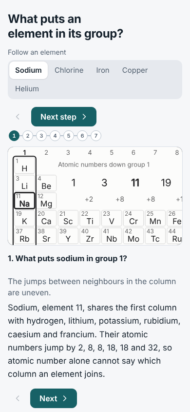
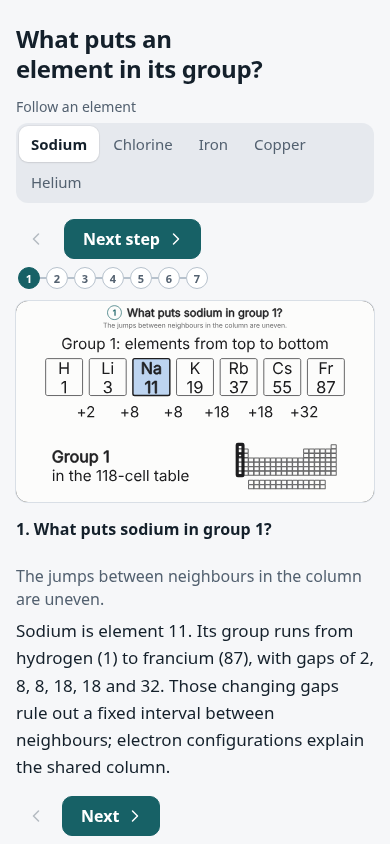
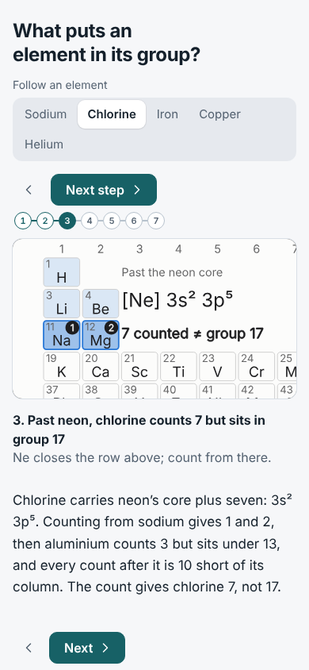
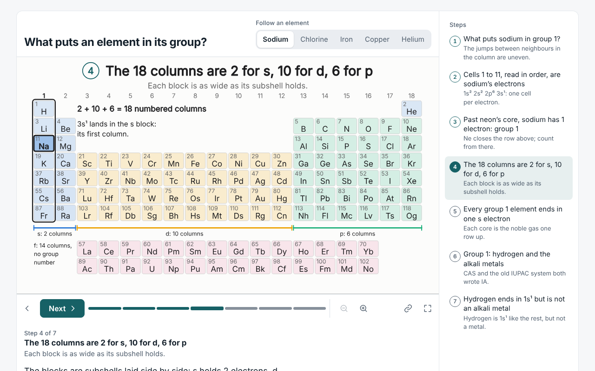
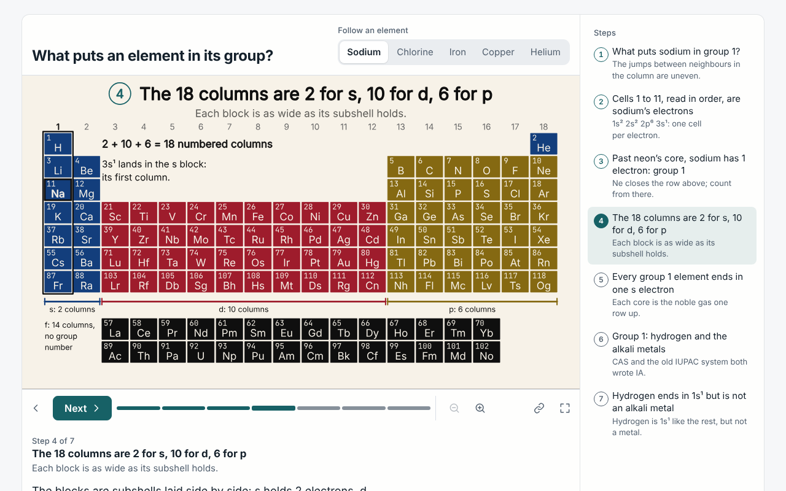
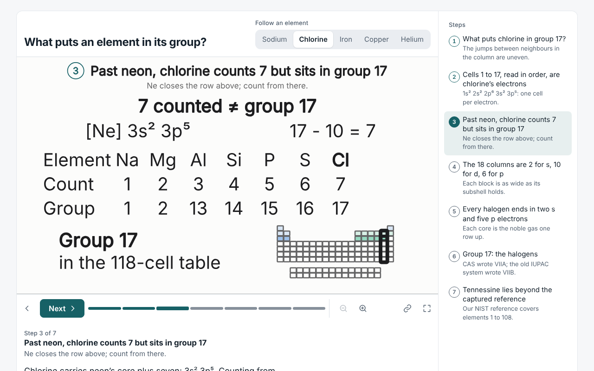
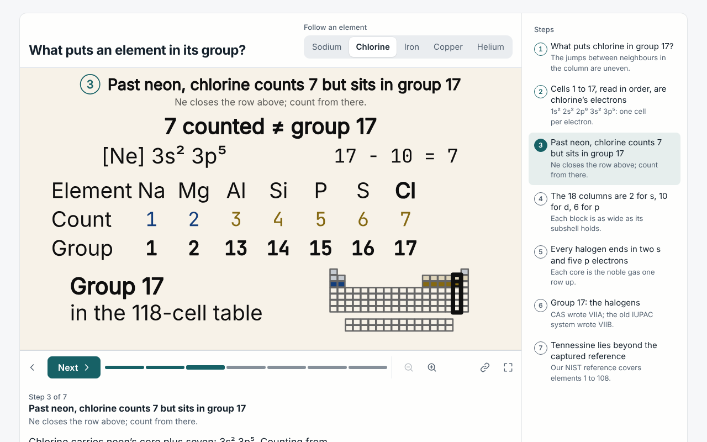
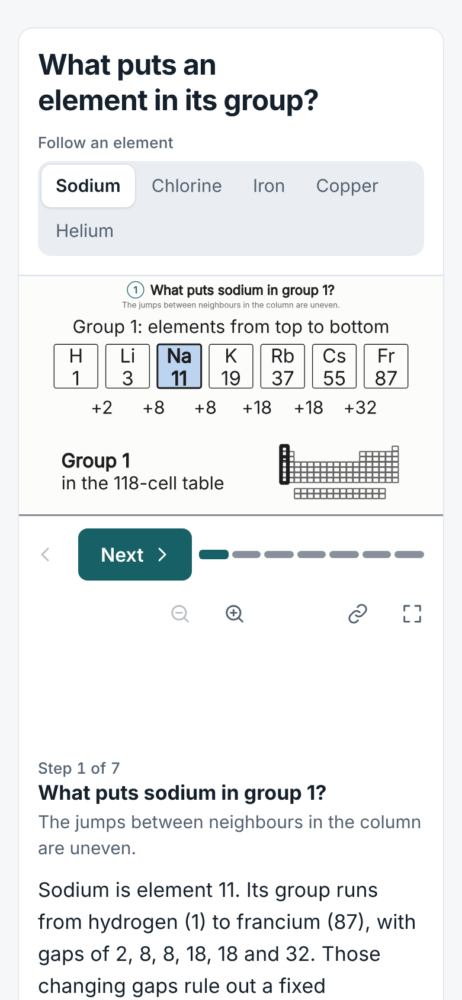
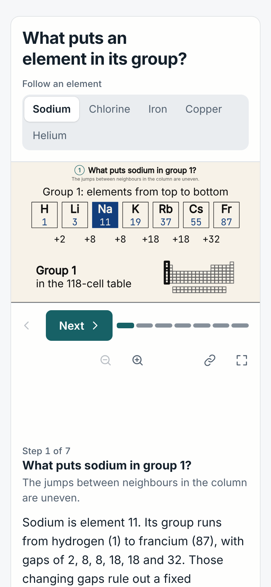

# Periodic-table groups as the gallery entry

This lesson is for a chemistry teacher explaining to a secondary-school student why elements with uneven atomic-number gaps share a column. It replaces `mr-cache` as the gallery entry. This record describes the source trail and verification; it is not a reader study or a chemist's review.

## What the pictures establish

| Case | Pivotal comparison | Boundary |
| --- | --- | --- |
| Sodium | The full family and atomic-number gaps; then `11 - 10 = 1`, `[Ne] 3s¹`, count 1 and group 1 | Hydrogen shares the s¹ ending but is not an alkali metal. |
| Chlorine | `17 - 10 = 7`; aluminium's count 3/group 13 and chlorine's count 7/group 17 | This scene predicts tennessine beyond its captured reference. |
| Iron | `26 - 18 = 8`; ruthenium's d⁷ s¹ ending retains the same count as iron's d⁶ s² | “Iron group” can also name iron, cobalt and nickel across a row. |
| Copper | Filling-rule `4s² 3d⁹` and listed `3d¹⁰ 4s¹` both count 11 | “Coinage metal” is a looser name than group 11. |
| Helium | Count 2 would put He? over Be; the actual table puts He over Ne in group 18 | Group placement uses the full shell, not this count alone. |

The opening and count steps use a compact comparison above a small, genuinely unlabelled 118-cell context table. Symbols, atomic numbers, jumps, counts and groups come from the model. The detailed table returns where the later steps use it. The full family and pivotal count comparison fit in one opening at 320 and 390 px.

## Model and sources

The model fills subshells in Madelung order (`n + l`, then `n`). It derives positions from that prediction and counts s, d and p electrons beyond the previous noble gas, excluding f. Before period 4, the p block needs the visible ten-column adjustment; helium's count of 2 differs from its group of 18. This table uses Sc, Y, Lu and Lr in group 3; other layouts use La and Ac.

The scene links the Group article at revision `1381612279` and NIST ASD. The frozen `nist-ground.json` records the ASD 5.12 query captured on 30 October 2026: elements 1–108, with 20 differences from the filling-rule prediction. The captured rows do not distinguish measured configurations from computed ones. Beyond that reference, this scene uses a prediction; its coverage limit does not establish the limits of all available scientific evidence.

Tests compare all 108 captured configurations and all 118 positions. During the audit, independent parsers expanded every raw NIST shorthand row, including nested `[Cd]` and `[Hg]` cores; the expansions, electron totals and subshell capacities matched the normalized fixture. That checked the captured data's consistency, not a fresh NIST download. Primary-source status claims could not be checked from this environment.

## Repairs after the adversarial audit

- **Phone comparison:** the old sodium opening had eight close-ups at 390 px, including unrelated f-block context. Chlorine's count opened on Na/Mg while Al's 3/13 and Cl's 7/17 were elsewhere. Both now show their complete comparisons together.
- **Desktop size:** on short laptop stages the old 0.2-unit count labels rendered at 11 CSS px. The compact count figures use larger text, and the smallest detailed-table labels are 0.22 units. `test/explain-periodic-reader.test.ts` measures the count labels at ten short laptop sizes and requires at least 12 CSS px; it passes with the player on `main`.
- **Paint order:** an unordered set treated reordered layers and changed copy counts as unchanged. The reviewer now matches paint occurrences and preserves copy counts and layer order where painted bounds overlap. Bounds include miter joins and square caps. Equivalent redraws and changes in ordering between disjoint shapes remain unchanged; an unrelated insertion does not make all following context a new subject.
- **Spotlight proof:** text reconciliation could miss a missing dashed outline. All eight boundary spotlights now have semantic keys, independent geometry/paint assertions, and explicit stroke claims.
- **CI ownership:** collection review previously ignored companion `scene.review.json` files. It now combines them with built-in expectations. Claims and their loader enter the review fingerprint; added, edited or removed expectations invalidate earlier shards. A final fingerprint check rejects changes during a review.
- **Prose:** captions distinguish changing atomic-number gaps from an impossibility claim, the shared s² p⁵ pattern from identical shell numbers, and this scene's reference coverage from a global scientific limit. Spatial wording follows the new matrix, and the helium description no longer announces an undrawn configuration. The edits were reviewed with [anti-slop-writing](https://github.com/adewale/anti-slop-writing).

## Verification owners

| Owner | What it checks |
| --- | --- |
| `test/explain-periodic-groups.test.ts` | Positions, configurations, exceptions and step state; text/state reconciliation; eight native spotlights; independent values and associations for 28 family members, 23 jumps, 16 count/group rows, three core equations, copper's two configurations and helium's two placements |
| `test/explain-periodic-reader.test.ts` | 20 fresh phone openings across five cases, two steps and two widths; 144 complete painted subjects; ten actual short-laptop count-label measurements |
| `scene.review.json` | Complete family and count comparisons in the opening, plus explicit outline strokes and the later steps' named subjects |
| `test/explain-story-review.test.ts` | Existing intent/clip/visibility boundaries, an independent spatial stack oracle, native-pixel miter/cap controls, the token-bucket redraw regression, and served CSSOM controls for hidden reordered or duplicated layers |
| `test/explain-review-scene.test.ts` | Both built-in and companion claims bind to actual scene ink; outside-author review retains its own boundary |
| `test/explain-review-plan.test.ts` | Exact shard/case/step inventory; stale claims or loader code reject old receipts |
| `test/reader-cross-browser.test.ts` | The existing hosted Mac WebKit/Safari journeys now include the periodic-table lesson and its claims |

The targeted enabled suite passed 34 tests. The complete catalog check passed 38 explainers and 196 cases. `rayner review` passed all five cases and 70 phone/desktop step rows with no console errors or runtime connections. Thirty fresh critical-opening screenshots were inspected across 320, 390 and 1280 px. Frozen-source forward and direct arrivals matched the resting records under both reduced and ordinary motion.

Deliberate defects were rejected: the old appearance set, missing/misplaced/unstroked spotlights, an incorrect painted count, old phone layouts, undersized desktop labels and changed companion expectations paired with older receipts. The original phone/desktop tests failed with ten views at 320 px and 11 px labels. A stroke-bounds mutant also failed the native-pixel miter and square-cap tests; the unchanged waiting token in all three token-bucket cases remains outside the refill obligations. Deliberate-defect controls ran in isolated copies.

The complete catalog and the latest hosted CI results are recorded on the PR. WebKit and native Safari are explicitly skipped on this Linux host; adding those assertions is not evidence that they passed on the new commit. Tests do not establish physical iPhone behaviour, speaker output or measured reader comprehension.

## Visual evidence

Before: `b944907`, 390×844, reduced motion, fresh direct entry. After: the repaired source at `fe1a016`, identical case, step and viewport, in the player that preceded `main`'s redesign and before the Atlas palette. Images include the visible caption as well as its picture.

| Sodium, `column`, before | After |
| --- | --- |
|  |  |

| Chlorine, `count`, before | After |
| --- | --- |
|  |  |

Regenerate with `rayner build scenes/explainers/periodic-groups --out out/periodic.html`, serve it with the generated response headers, and open `?element=na&step=column` or `?element=cl&step=count` at 390×844. `rayner review` saves every case and step at both standard widths.

## Atlas design language, inside the picture only

The scene draws its picture in [Atlas's design language](https://atlas-48p.pages.dev/about/design). The player is not restyled: `app/embed.css`, `app/embed.ts` and the gallery are exactly as on `main`, and every other explainer is unchanged.

- **Palette.** Paper `#f7f2e8`, black `#0f0f0f` and Grey Mid `#666` for secondary text. Block colours: s deep blue `#133e7c`, d warm red `#9e1c2c`, p mustard `#856912`, f black.
- **Cells.** Lit cells and the blocks step are solid block colour with paper lettering. Paper text on each reaches 4.67:1 (mustard) or better, so the small atomic numbers keep 4.5:1. Neon's core, in the count step's context table, stays a pale tint. Cells are square.
- **Numbers.** Atomic numbers, jumps, counts and the core equation use the monospace face. In the count rows each count takes its element's block colour. Family badges are block-coloured squares.
- **What stays as it was.** Boundary outlines stay black: a warm red outline would vanish against the d block. The step number drawn on the stage keeps the player's teal, so it matches the step bar.
- **One side effect from `main`.** `main`'s player tints its card 10% toward each explainer's paper. With the Atlas paper, this card's background takes a faint warm tint. Every explainer gets the same treatment from its own paper; nothing Atlas-specific reaches the player. On that tint, text, secondary text and the accent read at 16.3, 6.3 and 7.1:1 in the light theme and 10.6, 5.5 and 7.1:1 in the dark, above the 7, 4.5 and 3:1 that `test/embed-tint.test.ts` asks of the built-in palettes.

| | Before | After |
| --- | --- | --- |
| Blocks step, 1280×800 |  |  |
| Chlorine count, 1280×800 |  |  |
| Sodium opening, 390×844 |  |  |

Both columns use the player on `main`; only the scene differs (`bf24af0`'s palette before, Atlas after).

Nothing here was deployed. A future curated `site:export --only` selection must include the new required `periodic-groups` entry. The README's live preview should change only when that page is published.
