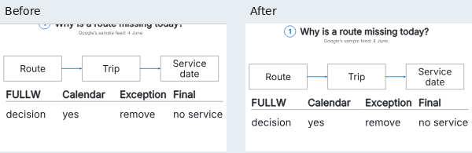
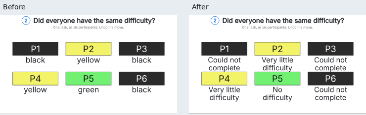

# PR #69 adversarial audit

Independent agents reviewed phone layout, reader behavior, test obligations, source claims and integration evidence. The starting revision was `210e347ba62de85a581dadbbc5a8de630baebd70`. Follow-up passes challenged the repairs and their tests. The user chose to consolidate the pending work into #69 targeting main.

The combined code includes main at `11ff5694757646185f238e22b4f7cb050c6a337b`, PR #60 through `e256d98f3975012c24a08d9325b9132e77ca6bcd` and the lesson improvements. Integration preserves the shipped player: one stepper row, responsive progress rail, measured header and caption sizing, watch and host APIs, endpoint controls, optional audio and card sizing. Atlas stays inside the periodic-table picture. Teaching/source navigation retains raw step identities and direct source links. The final production revision is `cf9e63bd9cdd7900148e4a931cdc406b903e5bdf`. PR #60 was merged separately into main at `e84bed57bb5c044ef887dd43b33895b3ae5e828f` during final validation; its exact final head was already integrated here. This audit does not merge #69 or deploy anything.

## Findings and repairs

| Finding | Repair and proof |
| --- | --- |
| Sodium’s count step offered a redundant second phone view. | The larger heading reduced available framing space. All required data was already complete in its first view at about 12.67px. Insetting the row headers restores one view without shrinking text. The five-element test requires all 20 phone openings to use one view and now checks 30 short-laptop stages at three widths. |
| Authored openings could cut through a question heading or leave its subtitle alone. | The planner records the full visible heading bounds. It accepts an opening only when the heading is complete or outside the view. A wide comparison may include the full heading instead of being forced into a narrower area below it. Native browser checks cover GTFS, token refill and the guarded-search comparison. |
| Unchanged and dimmed declared text could escape the reading-size calculation. | Declared subject labels participate even when a different object changes. Their opacity admission matches painted subjects; faint text is enlarged rather than silently omitted. Ordinary incidental-label selection is unchanged. |
| Rotation, unequal scaling and shear could inflate font-size credit. | Font measurements use the least scale of the transformed text basis and the browser’s effective path transform. Neither axis-aligned box height nor the geometric mean of unequal scales establishes readable size. A browser witness that previously measured a 3px em now measures 12px after the planner enlarges it. Rotation, native compression and CSS compression/shear have rejection controls. |
| An invalid step link could expose a leading reference step. | Fallback selects the first teaching step. Explicit source permalinks remain valid. The served fixture checks initial loading and case changes. |
| The traffic caption confused an ingress node’s source address with a destination pod’s address. | The short comparison now discusses the per-pod shares actually drawn. Correct packet-path and source-address modeling remains in the source walkthrough. Six independently expected share tables remain checked. |
| GNOME’s six-participant comparison named colors without explaining their categories. | Each participant has a semantic outcome label. The source colors and full report meanings remain recorded. Independent vectors cover all 36 participant/case outcomes, including the excluded approach. |
| The prior 320px preflight omitted undeclared comparisons, including the failing periodic step. | The canonical served review now checks independently claimed main openings at 320×568, including actual paint and 12px labels. It retains the full 390/1180 case/step/tour matrix. |
| A narrow-review receipt could otherwise disguise a missing check as an exclusion. | Catalog generation records per-case target, label and exclusion obligations before review. The merger rejects false exclusions, missing label metrics, labelled null minima, stale shards and incomplete inventories. All-detail scenes retain the reader’s main-path fallback. |
| The stack conflicted with player improvements already on main. | The integration uses the shipped player shell and combines both reader test models. It also catches a hidden progress bar overridden by CSS and guidance referring to an unavailable control. Main’s browser and benchmark contracts are retained. |
| Nondefault cases still clipped their required opening subjects. | A diagnostic ran all 550 narrow-opening obligations and found 11 failures: eight Monty random-host views, two 50-person birthday questions and one wrapped ring-buffer comparison. A shorter host rule, larger birthday numbers with a closer legend, and tighter ring-slot spacing keep the complete comparisons together. Dedicated served regressions cover every setting at 320 and 390 pixels and reject the original layouts. |
| Later periodic-table descriptions claimed partial filling and a pale core while the table painted all 118 cells by block. | The descriptions follow the painted phase. Independent expected fills, opacity, state, text and HTML descriptions cover all 35 periodic-table phases across the five elements. |
| Overlapping bounds and layer counts could establish changed artwork without any changed visible ink. | The reviewer compares native composites. Hollow paths, disjoint paint and fully covered duplicate removals cannot establish a change. Visible artwork revealed by removal does count. An adversarial counterexample caught removal of a cover's final occurrence; both that omission and its matching oracle omission were repaired, with explicit positive and negative controls. |
| The new composite check introduced a dependency missing from the review fingerprint. | The rasterizer joins the existing reviewer-file inventory. A mutation of its implementation rejects prior receipts. |
| The browser model assumed one zoom scale for every view. | It now tracks the selected view independently and predicts that view's scale and count. The original failing 308×400 sequence is a fixed regression. The full original seed and a second ten-case seed pass; the old oracle rejects the fixed example. |
| Clearing old callouts promoted whole unchanged context panels into automatic evidence. | Independent source contracts name the actual seasonal witnesses, token-cap facts, terminal rows/error, traffic shares and addresses, trusted nodes, and all 53 pen strokes. Literal values and native geometry are checked independently; missing-address and incorrect-subject controls reject incomplete evidence. |
| The stronger source contracts exposed real detail-tour gaps. | Reading intent makes the cap line and trusted nodes reachable. Seasons gains month labels, a wrapped polar-night readout, a July sample dot and stronger selected-latitude strokes, while retaining both seasonal references, curves and tables. Every required label keeps the 12px target. These detail tours can have several stops; the short main paths remain separate. |
| Startup sampling omitted the largest requested-font page. | `font-metrics` joins cache, token bucket and gamut in the existing startup cohort. The size and latency limits are unchanged. |

## Coverage and limits

The canonical inventory has 196 cases. It requires **550 main openings** at 320px and records **1,076 reference-step exclusions** and **32 main steps without opening claims**. The latter are the feature-tour recipe/result across 15 cases and the detailed pen drawing across two seeds. They retain the complete two-width tour review; their exemptions do not establish a complete 320px opening.

The earlier [copy/layout record](editorial-crap-2026-10-31.md) correctly called its 538 openings *declared* comparisons, but it was insufficient evidence for all teaching steps. The new catalog obligations include independent opening claims and explicitly inventory exclusions. Old receipts cannot validate the new reviewer.

The 550-opening diagnostic used saved HTML and source at `dce67be6369301f7cf31f4f267cacb6a10a7dd86`, build hash `8515eb1717c2cd727b8dea8add408cabe3f29435bedc9571dfeedd88e308998e`. It continued after failures: 539 passed and 11 failed. That sweep identified the three remaining layout repairs; it is not a canonical passing receipt. Separately, all 196 variants and 1,658 story frames passed the strengthened composite admission check before final browser validation.

A second diagnostic visited all 1,387 legacy 390px rows in the remaining 31 scenes: 1,365 passed and 22 failed. The failures covered seasons (8), token bucket (1), state machine (2), traffic policy (6), trust proxy (3) and pen marks (2). The first seven scenes had already passed the formal two-width run on the same source and build; their 542 rows are separate evidence. Aborted replay rows are excluded. Admission checks alone had not exposed these tour and semantic-target gaps.

An independent browser pass checks 98 main-step/width rows across 11 scenes at 320 and 390 pixels. It checks every body label against native SVG geometry, heading completeness and horizontal overflow. All five periodic elements are included. Separate rotated compressed-text witnesses measure the actual transformed em, independently of the planner’s size calculation. The capture receipts bind HTML artifacts and build inputs; source and engine hashes alone do not cover reader-app changes. After source repairs, the four changed token rows were rerendered. The other 94 rows and three squash witnesses retain their measured provenance and match the final source/build and complete HTML fingerprints.

Isolated mutation controls restore the old readers, font metrics, opacity cutoff, fallback and exclusion behavior. They reject the defects without modifying production bytes. One second-pass control also found a defect in the initial repair: `Text.textSize()` deliberately returns a geometric mean when stretched, so it could not supply the new readability metric. That public API remains unchanged.

## Matched-input captures

The five original comparisons use the audited PR revision `210e347ba62de85a581dadbbc5a8de630baebd70` as their baseline. Their after captures were rendered at `049a554e40167d1813a377a1cb6a8f43555cd8e4`; the token-refill capture was refreshed at `cf9e63bd9cdd7900148e4a931cdc406b903e5bdf`. Every retained artifact matches the final canonical bytes. The receipt records the render revisions and final validation revision separately. These are unscaled, lossless stage captures at the same settings and named step, with reduced motion. Each pair puts the baseline on the left.

At 320×568, `gtfs`, date `2007-06-04`, stop `airport`, step `reader-date`: inspect the question above the route/trip/service comparison. Its letters are complete after the repair; the service decision remains visible.

At 390×844, `gnome-files`, participant `P1`, step `reader-sample`: inspect the words below the six participant IDs. They explain the original categories without inventing task times or aggregating outcomes.

The [capture receipt](pr69-adversarial/captures.json) records settings, model state, artifact/build fingerprints, image hashes, all 98 native geometry results and three compressed-text witnesses. It also identifies the [GTFS stop](pr69-adversarial/comparison-gtfs-reader-stop-320.webp), [token refill](pr69-adversarial/comparison-token-bucket-reader-refill-320.webp) and [search guard](pr69-adversarial/comparison-latest-search-reader-guard-320.webp) pairs. A heading entirely outside a close-up remains available in the HTML caption; the repair does not require every close-up to include the scene header.

Three additional pairs use saved failing HTML at `dce67be6369301f7cf31f4f267cacb6a10a7dd86`, before the last layout repairs. Their after captures use `049a554e40167d1813a377a1cb6a8f43555cd8e4`, with unchanged source and artifact fingerprints verified against the final collection. Each uses 320×568, reduced motion and unchanged model state:

| Comparison | Input | What to inspect |
| --- | --- | --- |
| [Monty Hall](pr69-adversarial/comparison-monty-hall-host-320.webp) | Random host, choice C, stay, `host` | Door C and the full host rule fit in the opening. |
| [Birthday](pr69-adversarial/comparison-birthday-paradox-question-320.webp) | 50 people, any pair, `question` | Every card, the complete heading and both legends fit; day labels reach 12px. |
| [Ring buffer](pr69-adversarial/comparison-ring-buffer-reader-reuse-320.webp) | Wrapped storage, `reader-reuse` | Slot 4 joins the complete row, with queue order and pointers retained. |

The checks reproduce incomplete baseline subjects and complete repaired subjects. They verify the saved CSP, HTML hashes and equal model state. All eight pair images preserve the source screenshots' exact RGB pixels without scaling. The search-guard baseline already looks legible in its saved capture; that pair records a framing change while retaining both outcomes, rather than proving clipped text.

To reproduce, run `npm ci` and `npm run rayner -- preview scenes/explainers/gtfs` at either revision. Open `?date=2007-06-04&stop=airport&step=reader-date` at 320×568 with reduced motion. The independent served regression owner is `authored phone openings keep comparison ink readable without painting a clipped heading` in `test/explain-embed.test.ts`.

## Final validation

Final integrated results are recorded here after the canonical runs finish.

These checks establish the tested geometry, values and navigation behavior. They do not establish learning outcomes, arbitrary caption truth, physical-phone performance or local Safari support. Native Safari and WebKit have their existing Mac CI owners. No deployment or publication is part of this audit.
