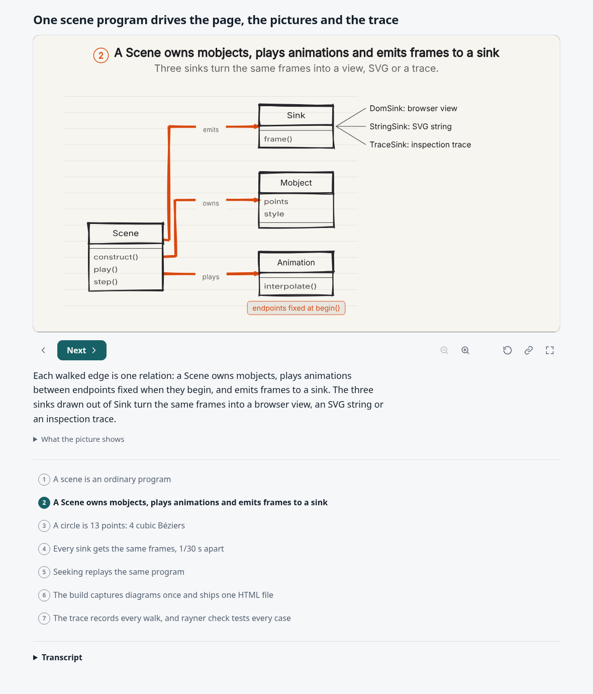
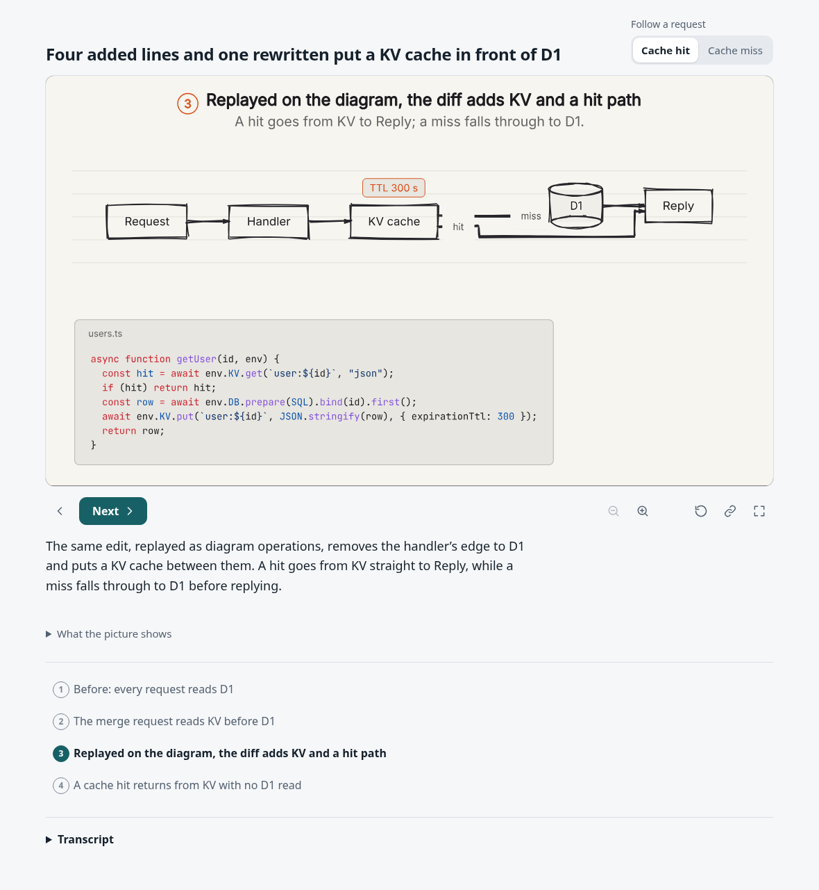
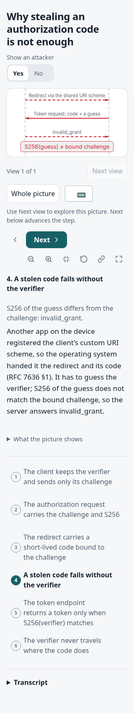
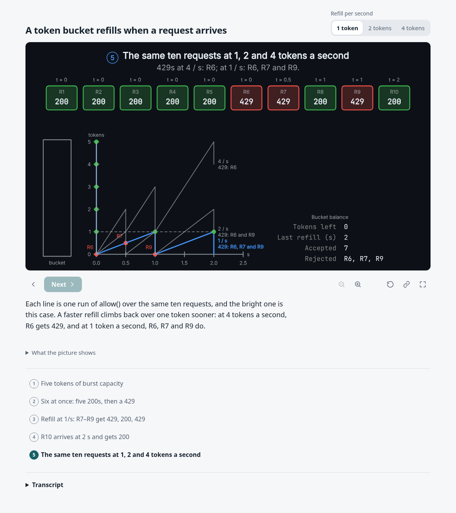

# Reader story audit

These findings amend the 0.1 release assessment. Size, bounds and case coverage do not establish that a reader can see the explanation. The baseline is main `2481c702865f53a3f82d6484c3887c9c81c4027f`; the implementation includes `93ac8a5` and `857f6f0`. Screenshots are actual, unedited Chromium captures on Linux.

1. **Lantern, objects — repaired.** At 1180 × 980, the orange route ran through “owns”, “plays” and “emits”. Connector labels now have a paper gap that travels with their owner through reveal, marks, dimming and focus. [Before](before-lantern.png), [after](after-lantern.png). A raster test removes only the lettering and checks its interior for route ink. It fails on the old renderer at `plays` and passes on the repaired one; a separate assertion requires the orange trail to remain visible.
2. **KV cache, after/request — spacing improved.** The “hit” and “miss” labels already had backgrounds, but their routes crowded them. The same clearance treatment gives them more space. [Before](before-mr-cache.png), [after](after-mr-cache.png). The raster test checks both words in both request cases, at both affected steps. This is a local clearance repair, not a new diagram routing algorithm.
3. **OAuth, attack — remaining phone defects repaired.** The current 390px baseline already opens on the attacker arrows; the verifier-only opening could not be reproduced. A new 320px browser assertion found the attack extending beyond the stage. Short notes now state what each arrow means, instead of displaying abbreviated hashes; full verifier and challenge values remain in the initial card. Screenshot review also found the overview map covering the note. The map now sits below the picture and keeps its layout space when hidden. [Before at 320px](before-oauth-pkce-attacker-yes-320.png), [after](after-oauth-pkce-attacker-yes-320.png). The browser independently projects all three attack arrows into screen coordinates and requires them wholly inside the opening stage at 320px and 390px; it also requires the map outside the picture. Keyboard/touch access and lack of layout movement have separate existing owners.
4. **Token bucket — reader language and separation repaired.** The internal `scene.state` heading and raw field labels are replaced by “Bucket balance”, “Tokens left”, “Last refill (s)”, “Accepted” and “Rejected”. [Before](before-token-bucket.png), [after at the final comparison step](after-token-bucket-trace.png). Review of the final comparison step found the longer labels overlapping the chart annotations. The readout moved right. Its existing independent value oracle still checks all five steps at all three rates; it now also rejects the debug heading and intersections between the readout and other text. The separate View/state equality oracle remains.
5. **Card truncation — audited, not reproduced as a value defect.** The [catalog audit](card-audit.json) visits all 142 settings cases and 512 card appearances. No resting card value contains an ellipsis; every full value appears in its card description. The trust-proxy card *label* used `app.set('trust proxy', …)`, which also reached descriptions. It now says “trust proxy setting”; [the rendered card](after-trust-proxy.png) retains the full setting and request values. OAuth notes contained authored shortened hashes; those are removed as described above. Pending request markers, elided code examples and deliberately abbreviated Git object IDs are distinct from values silently cut to fit. The card renderer scales values rather than inserting an ellipsis. These string checks do not prove that every value remains readable on screen.

## Reproduce

Use Node 24 and set `CHROMIUM_EXECUTABLE_PATH` if Chromium is outside Playwright's cache.

```sh
npm run check
npm test
npm run test:embeds
node --test test/explain-story.test.ts test/view-readouts.test.ts test/explain-models.test.ts test/explain-real.test.ts
```

Build a scene with `node tools/explain.ts build scenes/explainers/NAME --out out/NAME.html`, serve it with `node tools/explain.ts preview` or the production server, select the step named above, and capture at the recorded viewport. The OAuth URL is `oauth-pkce.html?attacker=yes&step=attack`. Token-bucket's comparison is `token-bucket.html?rate=1&step=trace` (also inspect rate 4). Refresh generated page pins through `UPDATE_GOLDEN=1` only in a separate commit after implementation review.

## Limits

The new tests make the named regressions fail in normal tests and the enabled browser lane. They do not understand arbitrary captions, establish complete overlap detection, or replace visual review. The card audit inspects every case's resting content; browser screenshots inspect the named flows, rather than every step of the catalog. A caption that names several objects needs an assertion naming those objects, like the three attack arrows here. macOS execution and repository Actions remain unverified in this cloud session. The original release prerequisites still apply.

## Visual review

| Surface | Accepted capture |
| --- | --- |
| Lantern: route gaps |  |
| KV cache: hit and miss clearance |  |
| OAuth at 320px: attack and note |  |
| Token bucket: final comparison |  |

Isolated old-code controls reject the route crossing, `scene.state` heading, readout/chart overlap and map overlay. The original full-arrow screen-projection assertion also rejects the baseline at 320px. Restored final-source checks pass. The controls run in a detached worktree; production files are unchanged during those runs.
