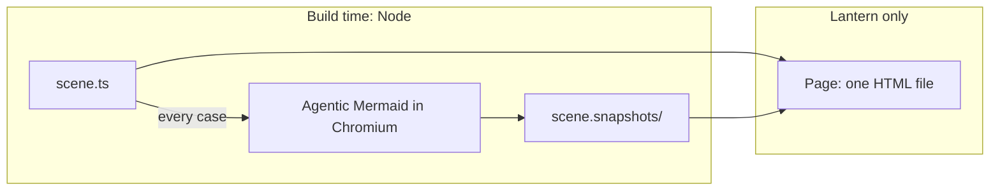

# Design: an explainer project forked from Lantern

Oct 24, 2026 · @Ade Oshineye

This is the dated design record, with later updates called out below. Current authoring contracts are in the reference. Contracts are in [the reference](../docs/REFERENCE.md), history in [the changelog](../CHANGELOG.md), and the fork base and engine changes in [upstream](../docs/UPSTREAM.md).

## Decision and purpose

Create a separately maintained, openly attributed fork of Lantern for one complete workflow:

> Write an explanation once as a native Lantern scene, publish it as a step-through website embed.

Five commitments define the project:

1. **Native scenes stay the authoring model.** An explainer is a Lantern `Scene` with named steps and captions. There is no JSON format, scene language or second runtime.
2. **A helper library does the repetitive work.** Small functions for common explanation techniques: show a diagram and build it in, send a token along its links, move it to its next version, focus on a part, show a card. Scenes call them like any other Lantern code and mix them freely with native drawing.
3. **Agentic Mermaid's styles are honoured.** A diagram keeps Agentic Mermaid's marks and colours. Default labels use embedded Inter; scenes can explicitly request replacement faces, including a style's face, through the lettering workflow. Labels still fit the captured layout's widths, and styles do not choose a font automatically. Every mark is addressable by its Mermaid id.
4. **The stepper comes first.** A reader moves through the explanation one step at a time, at their own pace, and can go back or link to any step.
5. **Reader settings offer another case to step through.** A scene may declare a few named options, such as whether an attacker is present, or a city. Each choice is a complete, stepped case, built and tested ahead of time.

## The problem, and why a fork

A good explanation has requirements that cross tool boundaries, and no single project owns all of them:

- Authors need control over a sequence of ideas: what appears, in what order, and what the reader looks at.
- Readers need to move through that sequence at their own pace, go back, and share a link to a step.
- Publishers need a portable file they can host with their own site.
- Diagram-led explanations need diagrams that look right. Without capture, that means redrawing by hand what Agentic Mermaid already draws well.

Lantern supplies the execution and rendering model. Agentic Mermaid supplies layout, styles and a typed model of every diagram. The fork owns the workflow between them: the helpers, the player, the build, and the documentation and releases.

**Why a fork, not only upstream changes.** General engine fixes can go upstream, and [upstream](../docs/UPSTREAM.md) lists them with their regression tests; scene registration and publishing tooling stay in the fork. A fork is justified only by the wider commitment: owning releases of the combined engine, helpers, player and tools, and supporting their users. That cost is real. Divergence should stay in the product and tooling layers, and the engine should change only for demonstrated needs. The project should not have started without a named maintainer; it did, and Ade Oshineye was named on 25 October 2026.

## What is inherited, and what changes

| Area | Inherited from Lantern | The fork |
| --- | --- | --- |
| Scene authoring | `Scene` classes with `step()`, `play()`, captions and state | Templates, examples, documentation; static `meta` and `settings` as registration conventions |
| Animation engine | Mobjects, animations, deterministic frames and seeking | Semantics preserved; general fixes listed in [upstream](../docs/UPSTREAM.md). The helpers run groups on linear time, because easing compounds in nested groups |
| Explanation helpers | `title`, `CodePanel` and `StateReadout` | Replaced by `explain/`: the stage, diagrams, cards, code panels and settings. Of the panels only `StateReadout` remains in the engine, because `stateView` builds one |
| Diagrams | `flowchart()` and Lantern's own Mermaid layout | Replaced by Agentic Mermaid capture, which honours its styles across families |
| Player | `app/player.ts` | Replaced by the embed player (`app/embed.ts`): stepper first, cases, zoom, accessibility |
| Builds | Bundled HTML | External scenes, snapshot build, portable pages, receipts |
| Inspection | Traces, text views, motion verifier | Kept; the helpers record every walk in the trace so tests can check it |

The owner chose to delete the inherited player, Lantern's Mermaid layout and the nine original scenes once the explainers rebuilt them, so the repository has one of each.

## Architecture

One scene file drives everything. At build time it runs once per case so Agentic Mermaid can draw the diagrams it asks for; the page runs the same scene again on Lantern alone.

The snapshot is the only thing that crosses from build time to the page. It holds each mark's resolved geometry and text runs as the style drew it, with the mark's id, role, endpoints, route and data channels, plus the verifier's findings. The browser never loads Agentic Mermaid, contacts a server, or recomputes a layout.

## Honouring Agentic Mermaid's styles

The integration keeps the style by not redrawing anything. Agentic Mermaid draws each mark; Lantern reads that drawing into its own shapes, and keys it by what the mark is.

1. **Render with the real style.** At build time the integration registers a capture backend with Agentic Mermaid's public `registerBackend`. It delegates to the style's real backend (default, rough or hybrid) and renders through `createMermaidRenderer`. The build asserts that the output equals a plain `renderMermaidSVG`, so capture cannot change the picture.
2. **Keep each mark's own SVG.** For every top-level part, the backend's `drawNode` output is kept with the part's id, role, endpoints, route and data channels. The final render's `<style>` and `<defs>` are kept once per diagram, so class rules, CSS variables, `color-mix()` and markers resolve exactly as in the browser.
3. **Read it into Lantern shapes.** Each mark becomes a group of Lantern paths and glyph-outline text in the style's own colours, strokes and fills. Rough strokes stay rough.
4. **Key by meaning.** A part is addressed by its semantic id: node `API`, edge `edge:C->R#0`, bar `bar:0:W3`, commit, task or slice. Labels attach to their owners, so they move with them.

A diagram therefore looks as it does in Agentic Mermaid's own renderer, and is made of ordinary Lantern objects that scene code can animate by id. Capture fails on any SVG the reader leaves unread.

**Known limits.**

- Some families come out narrow or tall in a 16:9 stage, and their text gets small. Authors choose a direction (`LR` or `TB`) per diagram and use `focus()` to enlarge parts, or with `{ camera: true }` to move the camera; `check` fails labels too small to read at a 1280 px stage. A 390 px phone draws the whole stage at 28% of that size, so the player opens each step there on a close-up of what changed, and `check` reports label sizes in those close-ups.
- The capture relies on `drawNode`, which is reachable but undocumented. [Upstream](../docs/UPSTREAM.md#agentic-mermaid) lists the Agentic Mermaid release that would replace it.

## The helper library

The helpers are plain functions in `explain/`; [the reference](../docs/REFERENCE.md#stage) lists them. A scene calls `stage(this, { style })` once, then uses what it needs, and everything else stays native Lantern: the ring buffer has no diagram at all, and the seasons draw an orbit beside a chart.

Diagrams are plain Mermaid strings. At build time every scene runs once per case, and each diagram it asks for is rendered and stored as a snapshot. A scene therefore never declares its diagrams in advance, and a case that fails to run fails the build.

## Reader settings

The stepper is the primary way to read an explainer, because the author decides the order of ideas and the reader decides the pace. The player stops after each step, so the caption can be read before the next idea arrives. Previous, Next, the steps list and the keyboard all work on steps, and `?step=` links to one. A step bar under the picture shows every step and fills as the current one plays; it is a stepper, not a seek bar.

Reader settings serve the stepper. A setting offers another *case* of the same explanation, and that case is again a full, stepped sequence. It is not a slider or a free input.

- **Declared by the scene.** `static settings = [{ id, label, options, default }]`. The scene reads the values with `settingsOf(this)` and may change its diagrams, captions, numbers and even which steps exist.
- **Finite and built ahead.** The build runs every combination. Authors run `check` or `review` before publishing; `build` does not repeat validation.
- **Under the title.** Cases are a segmented choice next to what they change. Switching keeps the reader's step, matched by name.
- **Optional.** The Lantern self-explainer has none, because nothing in it has a case worth choosing.

A good setting changes what the reader learns. In OAuth with PKCE, "Show an attacker" adds a step in which a stolen code fails. In the seasons explainer, "Observe from" Tromsø, London, Quito or Sydney shows polar day, Sydney's winter in June and the equator's flat year. In the merge-request explainer, "Follow a request" shows a cache hit or a miss after the change. An earlier prototype let readers switch a diagram's style; that was dropped, because a palette change teaches nothing, and each explainer now has one style chosen for it.

## The examples

The explainers rebuild every scene Lantern shipped with, including its self-explainer, and add topics of their own, among them OAuth with PKCE, the seasons, how Git names objects, and 2password. Each exercises a different teaching technique. Their cases, diagrams, styles and families are listed in `out/explainers/evidence.json`, written by `npm run demos:build`.

Three principles from Lantern carry through every example:

- **The animation shows what the program does.** The state machine asks `reduceSession()`, the token bucket runs `allow()`, the seasons compute the Sun's height, 2password runs a port of its own search, and the Agentic Mermaid morphs replay real `mutate()` ops. The scene never states an answer it did not get from the source.
- **Walks travel real links.** `walk()` throws on a hop the diagram does not have.
- **Native drawing where it helps.** Code panels, readouts, a gauge and an orbit are Lantern objects drawn beside the diagrams, because no diagram family fits them.

**Status, 25 October 2026.** The engine now has a camera, matching and diff-driven transforms, emphasis that stays, native charts, views of `scene.state`, code spans, and `Restore`, `TransformFromCopy` and `Succession` ([engine map](../docs/ENGINE.md)). Seven explainers use them, plus the Lantern explainer's camera focus: glyph, the KV-cache merge request, the state machine, the ring buffer, the seasons, the token bucket and Git. Not every feature has a user yet: `TransformDiff`, `Underline`, `stateView`, `plot`, `lineGraph`, `saveState`/`Restore` and code spans have one each, and `TransformMatching` with its own key, `Axes.bar`, `areaUnder`, a standalone `NumberLine`, a bare `Brace`, `code.lineSpan`, `TransformDiff`'s `hunks` option, the diff functions, `restore()` and `viewMismatch` have none ([reference](../docs/REFERENCE.md#engine-features)). `d.focus()` moves the camera only with `{ camera: true }`; by default it still rescales the artwork inside the diagram's box.

## What building the examples taught us

Rebuilding Lantern's examples in a prototype (the `agentic-mermaid` branch of a Lantern checkout, commit `4904cfa`, not in this repository) changed the spec in nine places. The first is the most important: a test caught a bug that review would have missed.

| What happened | Change to the spec |
| --- | --- |
| The ring buffer wrapped its animations in a `try`/`catch` for `Full`. The catch also swallowed the player's internal stop signal, so jumping to a step showed a different picture from playing to it. Lantern's seek test caught it | `check` runs the seek, motion and bare-runtime tests on every case of every scene, and fails a broad `catch` in `construct()` |
| Three scenes flashed black before their first diagram, because the stage's default paper was not the style's | The stage takes paper, ink and accent from the Agentic Mermaid style itself; hand-written palettes are optional |
| Decision chains laid out left to right became tall staircases; top to bottom became too narrow to read | Choose direction by shape, and check legibility: `check` now fails labels under 14 px at a 1280 px stage, and `shots` prints a contact sheet of every step |
| A node used in an edge before its labelled definition lost its label in Agentic Mermaid | Report upstream; until fixed, the build warns |
| Ten of the prototype's fourteen explainers needed native drawing; the ring buffer has no diagram at all | The helpers are two layers: the stage (paper, cards, code, settings), useful in any scene, and diagrams on top of it |
| Every Lantern example works by asking the program | A named pattern with a test helper: a scene's state at each step must equal the program's |
| In the prototype, rebuilt scenes were 87 to 176 lines, against 57 to 267 for the originals | Do not sell the helpers as shorter code. They buy real styles, settings and checks |
| In the prototype, one page held all fourteen explainers in 1.27 MB, 830 KB of it snapshots | A page holds one explainer and its own snapshots |

## Authoring and embedding

The command line is the contract: `init`, `preview`, `snapshots`, `check`, `build` and `shots`, the same on a laptop and in CI ([tutorial](../docs/TUTORIAL.md), [reference](../docs/REFERENCE.md#command-line)).

The lessons from [embed.oshineye.dev](https://embed.oshineye.dev/) and its [implementation notes](https://github.com/adewale/embed.oshineye.dev/blob/main/docs/LESSONS_LEARNED.md) are release requirements. An embed is a portable artifact with a stable interface:

- One self-contained HTML file per explainer, readable without JavaScript (poster and transcript), with no runtime network, fonts, storage or cookies.
- A raw iframe is the baseline; an optional self-hostable loader sizes it to its content.
- Step and settings live in the URL, so a link opens one picture, and history restores it.
- The resize message carries only a height, and the parent accepts it only from the expected origin **and** window, so two embeds on one page cannot resize each other.
- Hosting headers are generated beside the page, because `frame-ancestors` works only as a response header.

`npm run test:embeds` exercises these in Chromium against real cross-origin pages; the contracts are in [the reference](../docs/REFERENCE.md#page).

## How people will use it

It is an npm package with a command-line tool, plus an agent skill. An explainer is code that compiles to static files, so it lives in the author's repository and build.

| Who | What they use | Why this form |
| --- | --- | --- |
| Author, by hand | `npm i -D rayner`: the engine, helpers and Agentic Mermaid integration as one package with a pinned engine | Scenes are TypeScript; editor, types, tests and git all apply |
| Author or CI | The CLI | Snapshots, checks, pages are build steps |
| Coding agent | The agent skill in `skills/rayner-explainers/` | Agents already have a shell and an editor; a skill costs nothing to run |
| Agent with no shell | An optional MCP server wrapping the same CLI, later | Useful only where an agent cannot run the CLI |
| Reader | A static HTML page, or an iframe of it | No account, server or network |

MCP suits live access to a system, like a vault or a ticket queue. An explainer is source that is checked and built once, then served as files, so the CLI comes first.

## Decisions

| Decision | What it unblocks | Prepared so far |
| --- | --- | --- |
| Publishing the npm package | The `rayner` CLI for authors outside this repository | The package is named `rayner` (chosen 25 October 2026); 0.1.0 is prepared, with the CLI named `rayner` |
| Upstream relationship: write to Ivar Vong, then offer the engine fixes or declare a hard fork | Merging future upstream work without guesswork | [Upstream](../docs/UPSTREAM.md) lists the fixes with their tests |
| First outside author, and their topic | Evidence that the docs and skill work for someone other than the owner | A clean-machine trial can run once the topic is chosen |
| The next Agentic Mermaid release with the four changes | Deleting the undocumented `drawNode` coupling and the label workaround | The four changes are listed in [upstream](../docs/UPSTREAM.md#agentic-mermaid) |

## Risks and scope

| Risk | Response |
| --- | --- |
| Fork drift | Keep engine changes small and general; record the base; test upstream updates before merging |
| The helpers grow into a second language | Helpers stay functions a scene calls. No interpreter, no config-driven steps. A helper earns its place by being used in two examples |
| Agentic Mermaid's output changes | It changes when its owner releases it: pin versions, keep one snapshot file per diagram so a release's effect is a reviewable diff |
| Styles drift from the real renderer | Capture asserts byte equality with `renderMermaidSVG` and fails on unread SVG |
| Small text in tall or wide diagrams | Direction per diagram, `focus()`, the legibility check, and close-ups on phones |
| Settings multiply cases | Keep settings few and meaningful; the build runs every combination, so cost shows in CI time; 64 is the limit |
| An explainer that looks right but is wrong | Walks travel real links; morph ops are replayed; scenes ask the real program; cite sources; have an expert read it |
| Duplicate engine copies | Resolve scenes, helpers and player to one engine instance; the package smoke test checks it |

**Out of scope for the first release:** a JSON format or scene language; a new engine; pasted or typed diagrams, which would need Agentic Mermaid in the browser; continuous numeric inputs (typing a latitude) for scenes that draw only native geometry from a model, a later candidate once sampled checks exist; a visual editor; a hosted service that runs other people's scenes; narration; framework components.

## Sources

- [Lantern repository](https://github.com/ivarvong/lantern), and the pinned [self-explainer](https://github.com/ivarvong/lantern/blob/2c7bad533be25fbd56d26a9a2b6c5651743f011e/scenes/lantern.ts), [player](https://github.com/ivarvong/lantern/blob/2c7bad533be25fbd56d26a9a2b6c5651743f011e/app/player.ts), [state machine](https://github.com/ivarvong/lantern/blob/2c7bad533be25fbd56d26a9a2b6c5651743f011e/scenes/state-machine.ts), [token bucket](https://github.com/ivarvong/lantern/blob/2c7bad533be25fbd56d26a9a2b6c5651743f011e/scenes/token-bucket.ts) and [merge request](https://github.com/ivarvong/lantern/blob/2c7bad533be25fbd56d26a9a2b6c5651743f011e/scenes/mr-cache.ts) examples
- [Agentic Mermaid repository](https://github.com/adewale/agentic-mermaid), version 0.4.1 on npm
- [RFC 6749: OAuth 2.0](https://www.rfc-editor.org/rfc/rfc6749) and [RFC 7636: PKCE](https://www.rfc-editor.org/rfc/rfc7636)
- [NASA Space Place: What causes the seasons?](https://spaceplace.nasa.gov/seasons/en/)
- [kitlangton/2password](https://github.com/kitlangton/2password/tree/e011177d3e35f97a580b8903df6fff7e02593d16) at `e011177`
